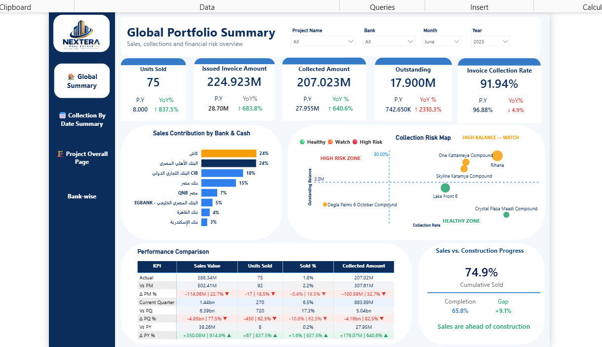
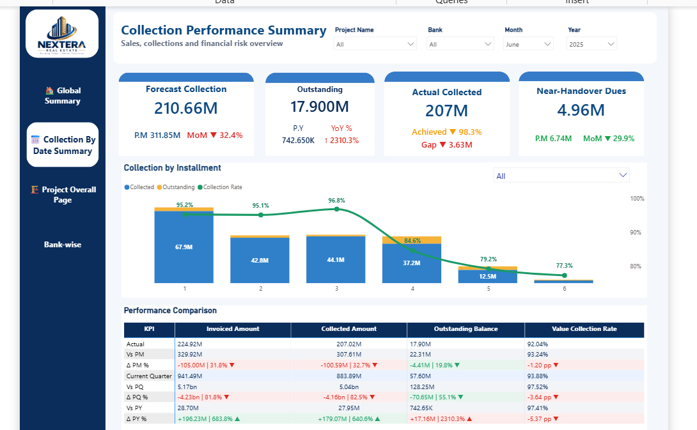
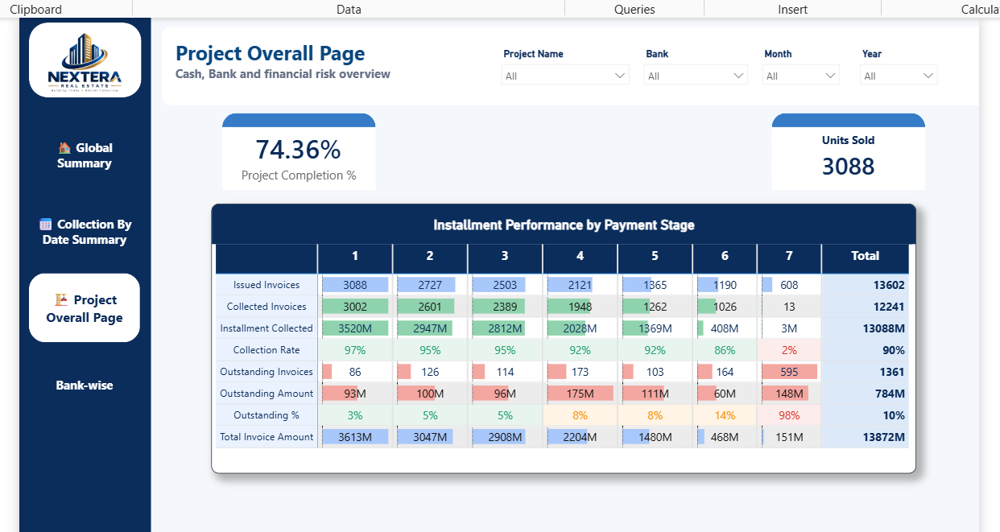
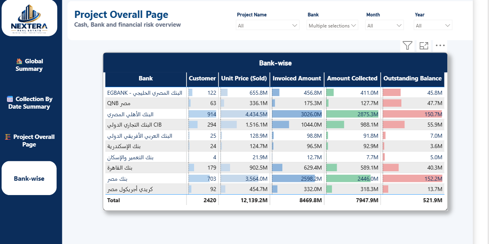

# Real Estate Sales & Collections Dashboard

Power BI dashboard built as the graduation project for the **Data Analysis Diploma (INSTANT)**. It gives a real estate developer a single view of sales performance, cash collection, and financial risk across projects, banks, and time.

## Business context

Real estate developers sell units on installment plans through multiple partner banks. Leadership needs to see, at a glance:
- How much has been sold vs. invoiced vs. actually collected
- Which projects/customers are falling behind on payments
- How collection performance compares across banks and installment stages
- Whether sales pace is keeping up with construction progress

This dashboard answers those questions with drill-downs by **Project, Bank, Month, and Year**.

## Pages

### 1. Global Portfolio Summary

Top-level KPIs — Units Sold, Issued Invoice Amount, Collected Amount, Outstanding balance, and Invoice Collection Rate — each with prior-year comparison and YoY growth. Includes a sales-contribution-by-bank breakdown and a **Collection Risk Map** that plots each project by outstanding balance vs. collection rate, flagging "High Risk / Watch" projects.

### 2. Collection Performance Summary

Forecast vs. actual collection, outstanding balance, and near-handover dues, plus a collection-by-installment-number chart showing how collection rate decays across later installments.

### 3. Project Overall Page

Per-project completion percentage and units sold, with an installment-performance matrix (issued invoices, collected invoices, collection rate, and outstanding amount) broken out by payment stage (1–7+).

### 4. Bank-wise

Customer count, unit price sold, invoiced amount, amount collected, and outstanding balance broken out by the 9 partner banks (plus cash), so finance can see exposure per bank.

### 5. Data model

Star schema: a `FactContracts` table at the center, related to `DimProject`, `DimDate`, `DimBank`, and `DimPayment`, enabling all the slicing above.

## Techniques used
- Star-schema data modeling in Power BI (fact/dimension tables)
- DAX measures for YoY growth, running collection rate, and risk segmentation
- Interactive slicers (Project, Bank, Month, Year) across all pages
- Scatter-plot risk mapping (outstanding balance vs. collection rate)

## Files
- `DiplomaGraduation_Project.pbix` — the full Power BI file (open in Power BI Desktop)
- `screenshots/` — page exports referenced above

## Author
Mohamed Yasser Kamal — [mohamedyasser6044@gmail.com](mailto:mohamedyasser6044@gmail.com)
