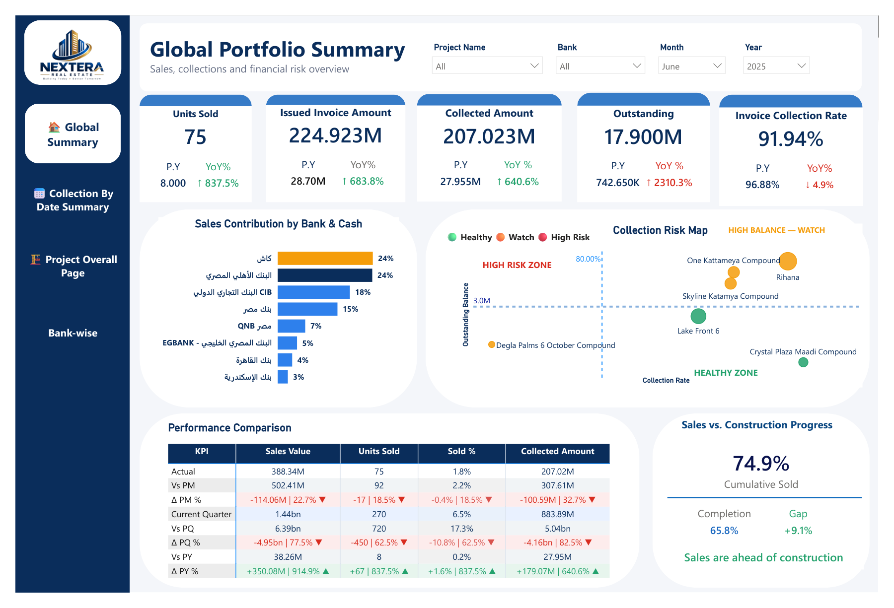
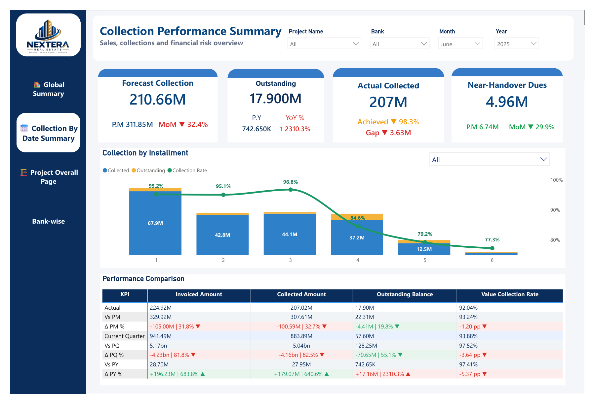
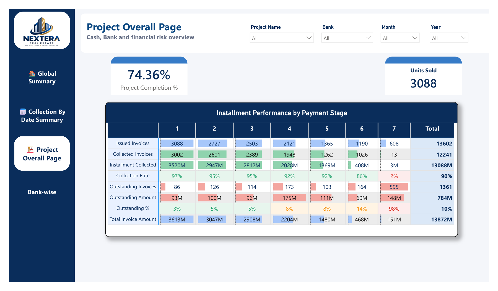
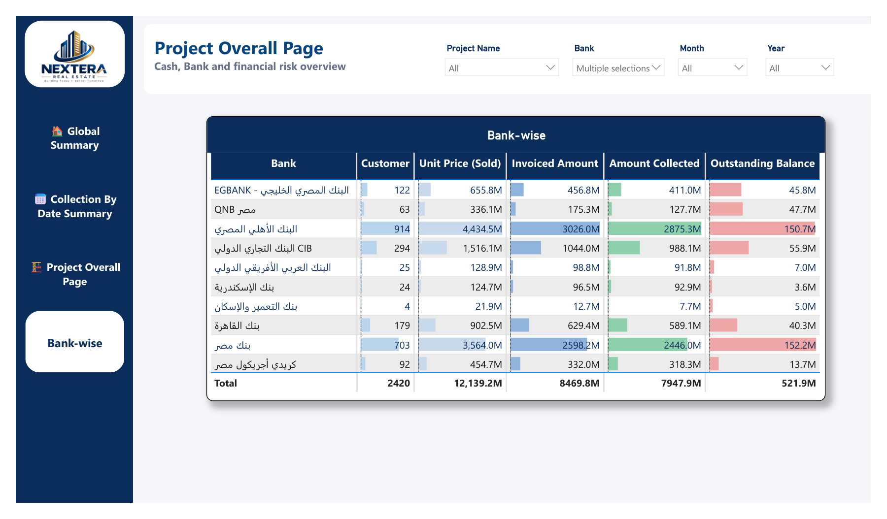
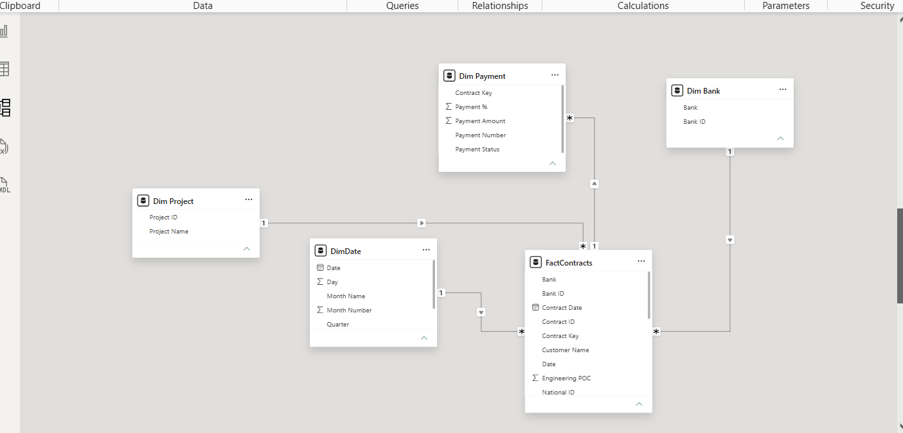

# Real Estate Sales & Collections Dashboard

My graduation project for the Data Analysis Diploma at Route Academy. It's a Power BI dashboard for a real estate developer that shows sales, money collected from customers, and which projects are falling behind on payments.

## The business problem

Developers sell units on installments through several partner banks. Management wants to know:
- How much was sold, how much was invoiced, and how much was actually collected
- Which projects and customers are late on payments
- How collection compares between banks and between installment numbers
- Whether sales are keeping up with construction progress

You can filter everything by project, bank, month and year.

## Pages

### 1. Global Portfolio Summary

The main KPIs (units sold, invoiced amount, collected amount, outstanding balance and collection rate), each compared with last year. It also shows sales by bank and a risk map that plots each project by outstanding balance and collection rate, so you can see the risky ones quickly.

### 2. Collection Performance Summary

Expected vs actual collection, outstanding balance and payments due near handover. A chart by installment number shows that the collection rate drops for later installments.

### 3. Project Overall Page

Completion % and units sold for each project, plus a table of invoices, collections, collection rate and outstanding amount for each installment stage (1 to 7+).

### 4. Bank-wise

Customers, sales, invoiced amount, collected amount and outstanding balance for each of the 9 partner banks and cash.

### 5. Data model

A star schema with `FactContracts` in the middle, linked to `DimProject`, `DimDate`, `DimBank` and `DimPayment`.

## Tools and techniques

- Star schema data model in Power BI
- DAX measures for year-over-year growth, collection rate and risk groups
- Slicers for project, bank, month and year on every page
- Scatter chart for the risk map (outstanding balance vs collection rate)

## Files

- `DiplomaGraduation_Project.pbix` is the Power BI file
- `screenshots/` has the pages above, exported from Power BI Desktop

## Contact

Mohamed Yasser Kamal, [mohamedyasser6044@gmail.com](mailto:mohamedyasser6044@gmail.com)
